  
  
  
  
  

   
  <a href="https://www.linkedin.com/in/joaohenrique-goncalves/">LinkedIn</a>
  &nbsp;•&nbsp;
  Engenharia de software
  &nbsp;•&nbsp;
  Go em estudo
  &nbsp;•&nbsp;
  Florianópolis, SC

